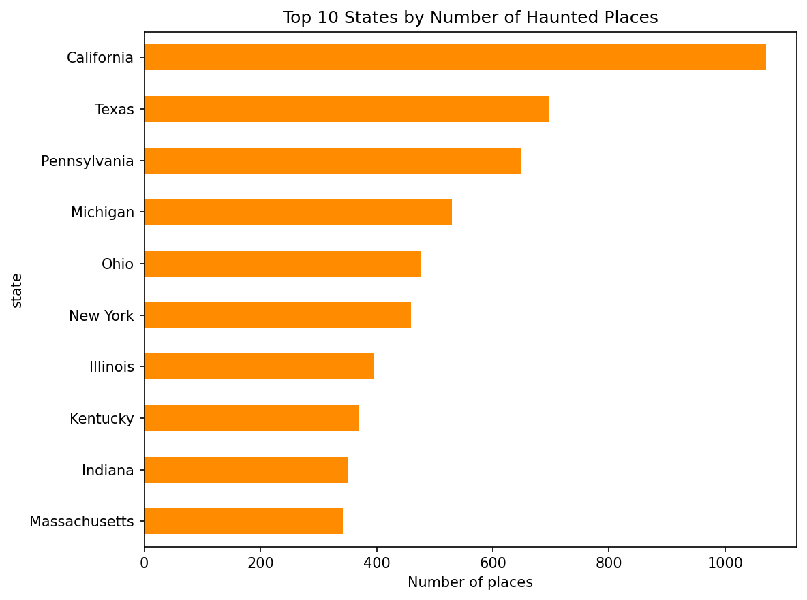
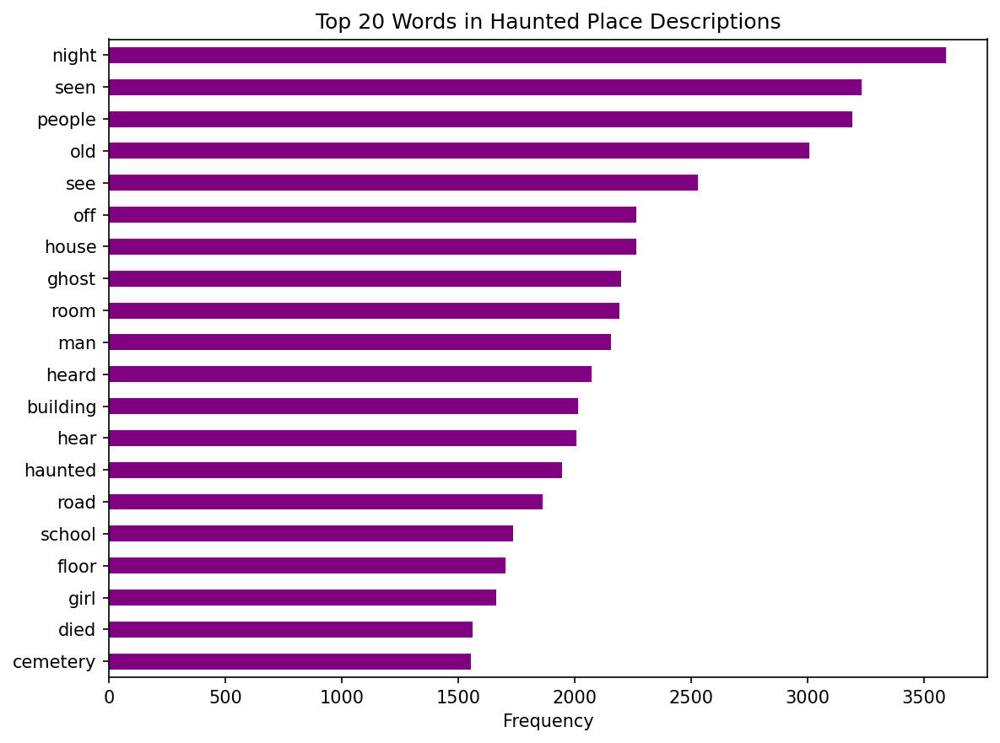
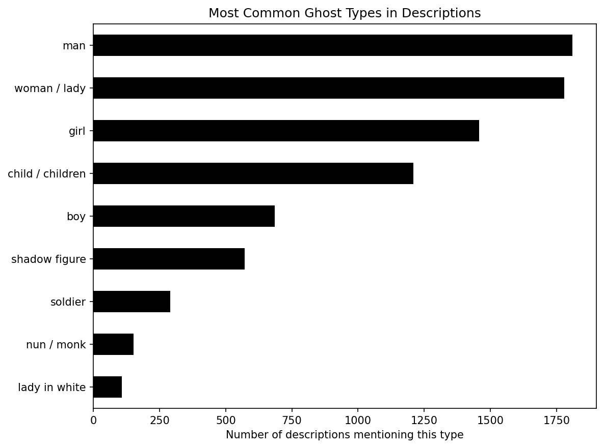

# Haunted Places in the USA 👻

Data analysis of ~11,000 reported haunted locations across the United States.

**Dataset:** [TidyTuesday, October 10, 2023](https://github.com/rfordatascience/tidytuesday/tree/main/data/2023/2023-10-10)

## What I did
- Explored the dataset with pandas
- Found the top 10 states by number of haunted places
- Built an interactive map of haunted hotspots with Plotly
- Ran text analysis on descriptions to find the most common words and ghost types

## Key findings
- California (1,070), Texas (696) and Pennsylvania (649) have the most haunted places
- Hotspots follow population density: the Northeast, the Midwest and coastal California
- The most common words are "night", "seen", "people", "old" and "house"
- The most frequently mentioned ghosts are men, women and girls

## Results

### Interactive map

[🗺️ Click here or on the image to open the interactive map](https://katya-davydova.github.io/haunted-places-analysis/haunted_map.html)

### Top 10 states

### Most common words

### Ghost types

## Tools
Python, pandas, matplotlib, Plotly, VS Code